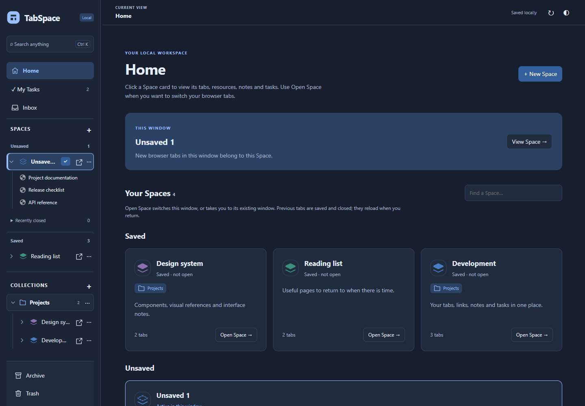
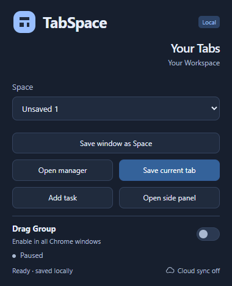
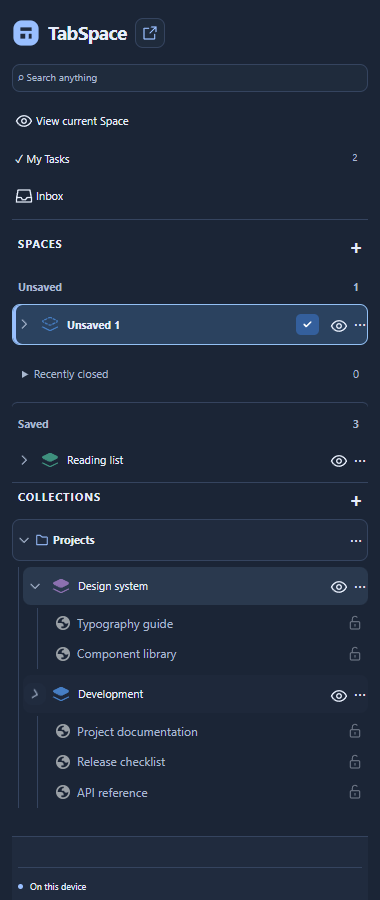

# TabSpace

**Your Tabs. Your Workspace.**

A local-first workspace for Chrome. Bring your tabs, useful links, notes and tasks together in Spaces, and return to each project with its browsing context ready.

[Download TabSpace](https://github.com/Kechos23/TabSpace/releases/tag/tabspace-v0.18.5) · [Download Drag Group](https://github.com/Kechos23/TabSpace/releases/tag/drag-group-v0.1.21) · [Gitea mirror](https://gitea.kechos.com/Kechos23/TabSpace) · [Installation guide](docs/USER_GUIDE_EN.md) · [Οδηγός στα ελληνικά](docs/USER_GUIDE_EL.md)

## A place for each project

- **Spaces and Collections** — organize projects, keep a separate browsing context for each and see their tabs in the sidebar tree.
- **Saved and Unsaved browsing** — start browsing immediately, save a Space when you want to keep it, and manage recently closed sessions with configurable retention.
- **Native tab groups** — see groups in the manager and sidebar, group or ungroup selected tabs, and move or copy tabs between Spaces.
- **Lock in Space** — retain selected tabs in a Saved Space even after closing them in the active session.
- **Resources, Notes and Tasks** — keep durable links and files, write formatted notes and manage checklists inside a Space or through My Tasks.
- **Quick access** — use the full manager, compact Chrome side panel or toolbar popup. Search your saved content and personalize the color theme.
- **Backups and recovery** — export and import JSON or ZIP backups, with local session checkpoints and drafts for recovery.

The organizer works offline without an account or subscription. Websites opened from it still use their normal network connections.

## Optional encrypted sync

Keep Saved Spaces, Collections, Inbox, Notes, Resources, Tasks and attached files available across computers through your own **Nextcloud or WebDAV server**.

Sync is opt-in. Choose the server and folder, grant access to that server and protect the cloud contents with a separate Sync password. Unsaved browsing, live windows and device preferences remain local. The popup provides a compact sync status indicator.

See [cloud sync setup](docs/CLOUD_SYNC.md) for connection, encryption, conflict handling and recovery details. Sync complements an independent backup; it does not replace one.

## Drag Group for Windows

Create a native Chrome group by dragging an ordinary tab over another. The paired indicator appears after a short dwell; release to group, or move back to cancel.

Drag Group is available **inside TabSpace** or as a **standalone extension**. Both editions share the same Windows helper. Use one active edition at a time.

The helper requires **Windows x64 and .NET 10 Windows Desktop Runtime**. In TabSpace it is optional: Spaces, Notes, Resources and Tasks work without it. The integrated edition uses the pinned manager as its controller; standalone uses its own pinned controller. See [setup and supported gestures](docs/drag-group-integration.md).

## Get started

| Download | Choose this when… |
| --- | --- |
| **TabSpace** | The manager, side panel and popup, keeping your current Chrome new-tab page. |
| **Shared Windows helper Setup** | You want to enable Drag Group inside TabSpace or use the managed helper with standalone Drag Group. |
| **Standalone Drag Group** | You want only drag-to-group. Install its extension ZIP and the shared helper Setup. |

1. Download `TabSpace-0.18.5.zip` and extract it into a permanent folder.
2. Open `chrome://extensions`, enable **Developer mode**, choose **Load unpacked** and select the extension folder containing `manifest.json`.
3. Open the toolbar popup and choose **Open manager** or **Open side panel**.

For Drag Group, run the shared helper **Setup.exe** and follow the [English](docs/USER_GUIDE_EN.md) or [Greek](docs/USER_GUIDE_EL.md) guide. It handles installation, repair/update and Windows Apps uninstall. No administrator registration or Windows startup service is required. A missing .NET Desktop Runtime is installed separately through Microsoft.

**Updating:** export a backup, keep the existing installation path, replace the packaged files and use **Reload**. Removing the extension first clears its active local data. Pause native controllers before updating helper files.

Both product releases are available on GitHub and Gitea, with matching downloads and SHA-256 checksums. The extensions are installed unpacked and updated manually; a Chrome Web Store listing is not currently provided. The helper Setup is currently unsigned. Supported environments and validation limits are described on each release page.

Popup and compact Chrome side panel

Screenshots use synthetic project data.

## Your data stays under your control

There is no analytics or developer-operated collection service. Organizer data stays in the local Chrome profile unless you explicitly export it or enable sync to your chosen server. Local profile data and exported backups are not password-encrypted; cloud sync encrypts the synchronized content. The native helper communicates locally and does not send website URLs or page contents to a server.

[Privacy and data handling](docs/PRIVACY.md) · [Permissions](docs/PERMISSIONS.md) · [Known limitations](docs/KNOWN_LIMITATIONS.md)

## Development and support

The repository contains TabSpace, standalone Drag Group and their shared helper. See [development](docs/DEVELOPMENT.md), [architecture](docs/ARCHITECTURE.md), [capability and validation map](docs/REQUIREMENTS_MATRIX.md) and [repository layout](docs/REPOSITORY_LAYOUT.md).

Current versions: **TabSpace 0.18.5**, **Drag Group 0.1.21** and **shared helper Setup 1.0.0**. See [release notes](docs/releases/tabspace-v0.18.5.md), [validation](docs/validation/README.md) and [contributing](CONTRIBUTING.md).

For a bug report, include the product/version, Chrome and Windows versions, reproduction steps and whether the helper or sync is enabled. Redact account details, browsing data, credentials and backups before sharing diagnostics.

## License

Copyright © 2026 kechos. The original TabSpace and Drag Group source code is licensed under the **GNU General Public License v3.0 only** ([GPL-3.0-only](LICENSE)). Third-party components retain their respective licenses and notices.

This license applies to the original source and the public distribution packages. Dependencies retain their own licenses; notices are included with downloads.

Designed by **kechos**.
